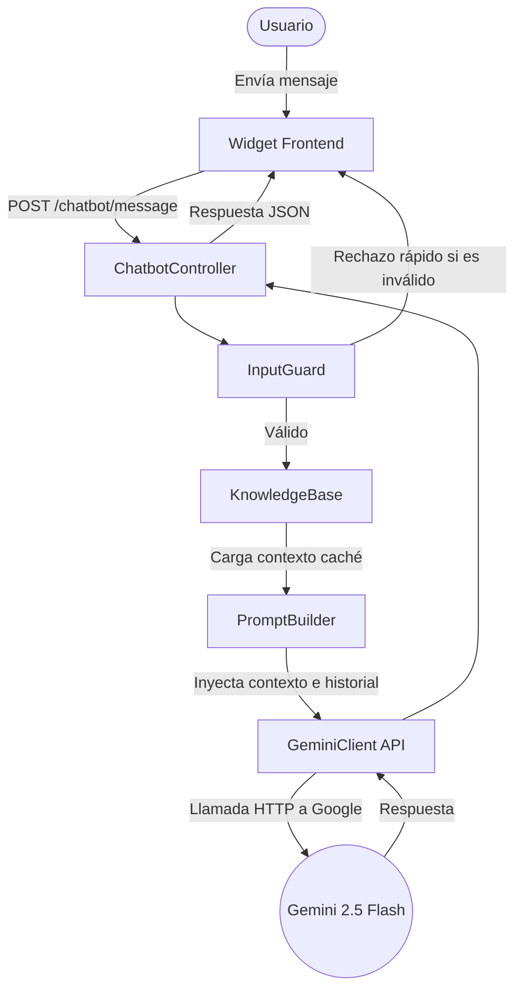

# ProUdeC y Chatbot Asistido por IA

Proyecto de Gestión del Conocimiento: Plataforma Web para potenciar las habilidades evaluadas en el Saber Pro, de los estudiantes de Ingeniería de Sistemas y Computación de la Universidad de Cundinamarca Seccional Ubaté.

Este proyecto incluye un **Asistente Informativo de IA (Chatbot)** diseñado para orientar a los usuarios sobre las funcionalidades de la plataforma y el contexto institucional, respetando los principios de la Declaración de la Persona Transhumana.

---

## 1. Enlaces Importantes
- **Despliegue en Vivo:** [Añadir URL de despliegue aquí]
- **Video de Sustentación:** [Añadir URL del video aquí]

---

## 2. Arquitectura del Chatbot

El módulo de chatbot se integra al backend de Laravel 12 sin acoplarse al núcleo de evaluación. Se comunica de forma unidireccional con Gemini 2.5 Flash.



---

## 3. Instrucciones de Instalación y Ejecución Local

1. **Requisitos previos:** PHP 8.5+, Composer, Node.js y MySQL 8.4.
2. **Clonar e instalar dependencias:**
   ```bash
   git clone <repo-url>
   cd ProUdeC
   composer install
   npm install
   ```
3. **Configuración del entorno:**
   - Copiar `.env.example` a `.env` y generar la clave:
     ```bash
     cp .env.example .env
     php artisan key:generate
     ```
   - Configurar los datos de la base de datos en `.env`.
   - Añadir tu clave de Gemini en `.env`:
     ```env
     GEMINI_API_KEY=tu_clave_real_aqui
     CHATBOT_ENABLED=true
     ```
4. **Base de Datos y Front-end:**
   ```bash
   php artisan migrate --seed
   npm run build
   ```
5. **Ejecutar el servidor:**
   ```bash
   php artisan serve
   ```

---

## 4. Base de Conocimiento y Ampliación

El chatbot opera en un **dominio cerrado**. Su conocimiento proviene de archivos JSON estáticos ubicados en `resources/knowledge/`.
- `proudec_general.json`: Contexto del proyecto.
- `proudec_funcionalidades.json`: Roles y flujos.
- `declaracion_transhumana.json`: Principios institucionales aplicados.
- `faq.json` / `limites_del_bot.json` / `proudec_tecnico.json`.

**Para ampliarla:**
1. Crear o editar un archivo JSON en `resources/knowledge/`.
2. Seguir el esquema: `{ "schema_version": "1.0", "category": "...", "entries": [ { "id": "...", "topic": { "es": "...", "en": "..." }, "content": { "es": "...", "en": "..." }, "source": "..." } ] }`.
3. El sistema cargará los cambios automáticamente.

---

## 5. Prompt del Sistema y Medidas Anti-Alucinación

- **Inyección de Contexto (Context Stuffing):** Se entrega toda la base de conocimiento en la instrucción del sistema (System Instruction).
- **Dominio Cerrado:** Se le instruye explícitamente responder "No dispongo de esa información" si la respuesta no está en los JSON.
- **Temperatura Baja:** (0.2 - 0.3) para forzar respuestas consistentes.
- **Defensa contra Inyecciones (InputGuard):** Filtro previo de expresiones regulares y límites de longitud para bloquear intentos de *prompt leaking* antes de llamar a la API.

---

## 6. Declaración de la Persona Transhumana / Transhuman Person Declaration

### Español

1. **Síntesis de la Declaración:**
   La Declaración de la Persona Transhumana promueve un ser libre, autónomo, que aprende de sí mismo y de su entorno, utilizando la tecnología como un medio para el bienestar y no como un fin, forjando la responsabilidad y el aprendizaje continuo en comunidad.

2. **Principios aplicados al proyecto:**
   | Apartado | Principio | Cómo se refleja en ProUDEC y en el chatbot | Evidencia |
   |---|---|---|---|
   | 1 | Organizo y dirijo mi propia vida | El estudiante decide su ruta de práctica; el bot orienta sin imponer. | `limites_del_bot.json`, progreso. |
   | 4 | Aprendo de mi vida y de las buenas prácticas | Retroalimentación en simulacros; el bot guía sobre el uso de la app. | `docs/requirements.md` |
   | 7 | Tecnología como medio, no como fin | La IA asiste; la evaluación no depende de ella, fomentando el saber real. | `docs/decisions.md` |
   | 8 | Contribuyo a la comunidad | Es un proyecto regional para la Seccional Ubaté. | `ProUdeC_CONTEXT_MASTER.md` |
   | 9 | Libre, autónomo y responsable | El bot no entrega respuestas de los exámenes; cuida el esfuerzo propio. | Reglas del prompt. |
   | 10| Forjo mi autonomía y responsabilidad | Transparencia sobre ser IA con límites definidos en la interfaz. | Aviso en widget. |
   | 11| Actos que no hacen daño | Privacidad de datos: no se envían datos personales al modelo de IA. | `docs/security.md`, fase backend. |

3. **Respuesta reflexiva a la pregunta:**
   *(a) ¿De qué manera el agente/chatbot respeta y fomenta los principios de la Declaración de la Persona Transhumana de la Universidad de Cundinamarca en el contexto del aprendizaje y la interacción tecnológica?*
   
   El chatbot actúa respetando la tecnología como medio (Apartado 7), puesto que el núcleo de evaluación académica depende exclusivamente del esfuerzo del estudiante; la IA únicamente sirve como orientador y guía sin intervenir en calificaciones. Asimismo, fortalece la autonomía y responsabilidad (Apartados 1, 9 y 10) al tener instrucciones estrictas de no resolver evaluaciones ni entregar respuestas, salvaguardando así el proceso genuino de aprendizaje. Finalmente, promueve un entorno tecnológico seguro y ético (Apartado 11), al operar en un dominio cerrado sin exponer datos personales, contribuyendo a una mejora comunitaria accesible e inclusiva en la Seccional Ubaté.

4. **Implementación Técnica:**
   - **Privacidad:** No extrae ni envía datos de las tablas de usuarios o resultados a la API de Google.
   - **Transparencia:** El widget siempre tiene el aviso estático: "Asistente de IA. No reemplaza al docente...".
   - **Límites (Guardrails):** Instrucción rígida a nivel de *System Prompt* de no asistir en responder preguntas de las pruebas.

### English

1. **Summary of the Declaration:**
   The Transhuman Person Declaration promotes individuals who are free, autonomous, and capable of learning from their environment. It views technology as a means for well-being rather than an end, forging responsibility, and fostering continuous community learning.

2. **Principles applied to the project:**
   | Statement | Principle | Reflection in ProUDEC and Chatbot | Evidence |
   |---|---|---|---|
   | 1 | I organize and direct my own life | Students choose their practice paths; the bot guides without dictating. | `limites_del_bot.json` |
   | 4 | I learn from my life and best practices | Feedback loops on assessments; the bot helps navigate the platform. | `docs/requirements.md` |
   | 7 | Technology as a means, not an end | AI assists, but the core assessment depends strictly on student knowledge. | `docs/decisions.md` |
   | 8 | I contribute to the community | Regional knowledge project tailored for the Ubaté Sectional. | `ProUdeC_CONTEXT_MASTER.md` |
   | 9 | Free, autonomous and responsible | The bot does not provide assessment answers; protects personal effort. | Prompt rules. |
   | 10| I forge my autonomy and responsibility | Transparency about being an AI with clear UI limits. | Widget disclaimer. |
   | 11| Transformative acts that do no harm | Data privacy: no personal data is sent to the AI model. | `docs/security.md` |

3. **Reflective answer to the question:**
   *(b) How does the implemented AI agent/chatbot align with and support the Transhuman Person Declaration of Universidad de Cundinamarca regarding ethical AI integration, human augmentation, and educational transformation?*
   
   The chatbot integrates ethical AI by strictly operating in a closed domain, ensuring that no personal data is sent to the LLM and remaining transparent about its artificial nature (Statement 11). It supports human augmentation by acting as a 24/7 bilingual guide, extending access to information and platform features without replacing the core educational effort of the student or the role of the instructor (Statements 1, 9, and 10). A critical design decision is the strict limitation that prevents the AI from solving assessments; this intentional friction respects the educational transformation by preserving the student's responsibility and autonomy in acquiring true knowledge (Statement 7).

4. **Technical Implementation:**
   - **Privacy:** User database contents are completely isolated from Gemini calls.
   - **Transparency:** Clear UI disclaimer clarifying the bot's identity and limitations.
   - **Limits:** Strict system prompt guardrails deny the extraction of correct answers or exam data.

---

## 7. Pruebas

El sistema cuenta con un suite de pruebas automatizadas (Feature y Unit) para el chatbot. Se ejecutan con:
```bash
php artisan test --filter Chatbot
```
*Todas las pruebas que interactúan con la API de Gemini están simuladas (mockeadas) con `Http::fake` para que corran sin consumir cuota de red ni requerir una clave.*

---

## 8. Limitaciones y Pendientes

- **Limitaciones conocidas:** El chatbot no tiene memoria a largo plazo de sesiones pasadas (el historial se limpia o se acota a los últimos 6 turnos de la sesión activa). Tampoco puede verificar el progreso real del estudiante, por políticas de privacidad intencionales.
- **Pendientes de verificación:** Confirmar la cifra exacta de competencias evaluadas, para homogenizar cualquier posible contradicción en manuales antiguos vs. el desarrollo actual.
